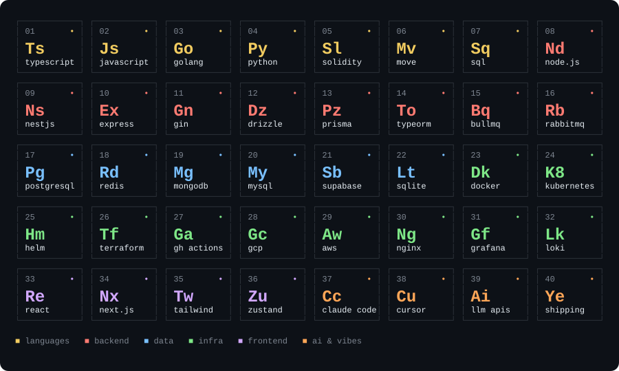

<div align="center">

<picture>
  <source media="(prefers-color-scheme: dark)" srcset="./assets/saturn-dark.svg">
  <source media="(prefers-color-scheme: light)" srcset="./assets/saturn-light.svg">
  
</picture>

</div>

### Yo, I'm Sagar 🪐

I keep the lights on for **50,000+ creators**, and occasionally turn them off by accident and back on again before anyone notices.

Backend + DevOps at **Scribble Network**. I walked in as the first backend hire, sat next to the CTO and ended up owning basically everything with a port number: the APIs, the databases, the pipelines, the clouds (plural, we moved house once). Before that I took a creaky Drupal site at **BuidlersTribe**, rebuilt it on MERN, and features started shipping **30% faster**.

```console
$ whoami
sagar bera, backend & devops, 127.0.0.1 🇮🇳

$ cat /etc/vibe
ship fast · break nothing (mostly) · adapt fearlessly · log everything

$ uptime
3.5+ yrs in the prod trenches
```

<br>

## 🎧 The Hits

**[Kili AI](https://trykili.ai)** — ads that show up only while your AI agent is "thinking", and pay you back for the tokens. Devs keep **50% of revenue**, paid in stablecoins or Stripe. Shipped the whole thing (public API, internal server, two dev packages) in **4 days**.

**[Scribble Brands](https://brands.scribble.network/)** — makes ChatGPT, Gemini, Perplexity, Copilot and Grok talk about your brand. One client went from **2% → 20%** AI citation share in 3 months. Landed in Product Hunt's **Top 3 AI Products of the Week**.

**[Scribble Creators](https://creators.scribble.network/)** — creators write, brands pay. **50,000+ creators**, **800+ campaigns**, **$500,000+ paid out**.

**[GitOpener](https://gitopener.vercel.app/)** — a friendly on-ramp for your first open source PR, with live guides and GitHub sign-in. Built with zero AI code, back when that was the only way. ([source](https://github.com/pbclife/gitopener.vercel.app))

<br>

## 🔥 War Stories

- 🐘 **Mongo → Postgres.** Moved the core data over so the schema finally made sense, queries got faster and new features stopped fighting back.
- ☁️ **AWS → GCP.** Moved production between clouds with the CTO to save money, and the product stayed live the whole time.
- 🚨 **3 a.m. outage.** The estimate was 1–2 hours. It was fixed in **5–10 minutes** with Cursor riding shotgun.
- 🤖 **Robots doing chores.** GitHub Actions ships to prod, while Loki and Grafana watch the logs so I don't have to.
- 🔐 **Auth from scratch.** Magic links, plus Google and X login.
- 🪙 **Crypto side quests.**
  - A Telegram bot that sends crypto to anyone with just their username.
  - Rabots, one-click DeFi yield for beginners.
  - Smart contracts in Solidity and Move for prediction markets and auto-trading.
- 📨 **Microservices** for notifications, webhooks and a crypto payout faucet.

<br>

## 🧪 Periodic table of things I Break & Fix

<picture>
  <source media="(prefers-color-scheme: dark)" srcset="./assets/stack-dark.svg">
  <source media="(prefers-color-scheme: light)" srcset="./assets/stack-light.svg">
  
</picture>

<br>

## 🌱 Open Source & Side Quests

- 🧩 Contributed to [Mintlify components](https://github.com/mintlify/components) and [WeMakeDevs](https://github.com/WeMakeDevs/wemakedevs-archive).
- ▶️ Earned a YouTube **Silver Play Button** on [@ShadowBoy](https://www.youtube.com/@ShadowBoy). Yes, really.
- 🎤 Hosted the MaHa Hackathon. Someone has to hand out the pizza and the deadlines.
- 🏅 Certifications:
  - Postman Student Expert
  - HackerRank 5 Star
- 🗣️ Speaks English, Hindi and Bengali, plus fluent `SELECT * FROM`.

<br>

## 📡 say hi

[sboy99.xyz](https://www.sboy99.xyz) · [resume](https://www.sboy99.xyz/resume) · [linkedin](https://www.linkedin.com/in/sagar-bera) · [x / @0xSagar_](https://x.com/0xSagar_) · [contact.sagarbera@gmail.com](mailto:contact.sagarbera@gmail.com)

<br>

<picture>
  <source media="(prefers-color-scheme: dark)" srcset="./assets/waves-dark.svg">
  <source media="(prefers-color-scheme: light)" srcset="./assets/waves-light.svg">
  
</picture>
